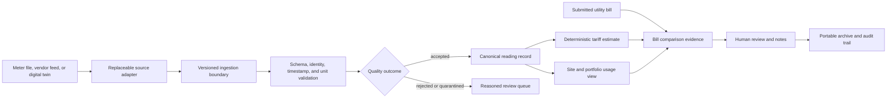

# Architecture and data contract

Status snapshot: 21 October 2026. This document distinguishes implemented prototype code from proposed production architecture. Nothing here implies a live meter deployment, hosted database migration, or utility-grade billing service.

## Product boundary

The first product hypothesis is electricity visibility and bill evidence for multi-site property or business operators. It should help a reviewer understand what readings were received, whether they are usable, what tariff assumptions produce an estimate, and how that estimate compares with a submitted bill. This buyer problem remains unvalidated. Home and office examples in the browser are synthetic; industrial content is demonstration material only. The rejected Schneider-linked concept is not a product requirement.

The first release should be read-only for physical data sources. It must not control relays, breakers, or machinery. Billing calculations remain deterministic and explainable. AI is optional future work, never the source of billed totals.

## Implementation status

| Capability | Current status |
|---|---|
| Browser portfolio and digital-twin scenarios | Synthetic demo; no live source |
| Measurement normalization and tariff estimates | Domain module with deterministic tests |
| Supabase multi-tenant migration and RLS tests | Additive migration; 27 pgTAP assertions previously passed in CI on a clean local stack; not applied to a hosted project |
| Database lint and local-stack cleanup | Added to the CI workflow; latest run must confirm the new steps |
| Versioned JSON energy archive parser/serializer | Implemented in src/domain/energyArchive.mjs; not connected to UI/storage and not covered by dedicated archive tests |
| Authenticated ingestion API, persistent production dashboards, live meter adapters | Not implemented |
| Official utility invoices, payment processing, device control, AI inference | Not implemented |

## Data flow

The demo exercises a local synthetic source through the same measurement validation and deterministic estimate logic used by its domain utilities. A future source adapter must enter through a server-side authenticated ingestion boundary; it must never bypass schema, quality, or tenant checks.

## Canonical measurement envelope

The migration and domain module describe energy data independently of a specific board or vendor. The core fields are:

- Organization, site, optional area/asset, meter, and optional adapter identifiers define hierarchy and ownership.
- Schema version, stable event ID, and optional source sequence/reference support reproducibility and duplicate detection.
- Measured-at is event time with an explicit offset; received-at is a separate server timestamp. The site timezone is configuration for display and tariff evaluation.
- Kind distinguishes interval energy, cumulative energy, power, voltage, and current. Bounds are required for interval-energy measurements.
- Value and unit retain physical meaning. Supported domain conversions currently include Wh/kWh, W/kW, V, and A.
- Quality is valid, suspect, invalid, or quarantined. Missing, stale, invalid, and incomplete readings must never be silently interpreted as zero.

The domain validator handles supported kinds/units, finite values, timestamps, duplicate IDs within one batch, and cumulative counter deltas. A decrease is quarantined unless a configured register maximum explains rollover. It does not provide durable cross-request idempotency, source authentication, a reorder buffer, or persistent raw-payload storage. The twin makes selected fault scenarios visible but does not prove the same behavior against hardware.

## Tariff estimate and bill comparison

Tariffs need currency, timezone, effective dates, billing period, and explicit charge components. The current deterministic estimator supports flat and time-of-use examples and returns a cost estimate with calculation details. It can split an interval across local-hour tariff boundaries and rejects gaps, overlaps, missing coverage, and incomplete expected interval sets. It is not a jurisdiction-ready invoice calculation.

A future bill comparison should preserve the uploaded or entered bill amount, bill period, source document reference, tariff version, reading window, calculated estimate, variance, and reviewer notes. It must label the result as a comparison or estimate, not an authoritative charge. Any document handling needs privacy, retention, access, and deletion rules before accepting real customer bills.

Production tariff work still requires customer-specific review of fixed and demand charges, taxes/fees, adjustments, net metering, meter multipliers, precision/rounding, timezones/daylight transitions, billing cutoffs, and correction workflows. AI must not change bill totals.

## Portable archive contract

The current utility exports and revalidates a JSON document with format identifier wattwise.energy-archive and schema version 1. It requires arrays for organizations, sites, areas, assets, meters, adapters, measurements, tariffs, billing runs, insights, and interventions. Measurement entries receive basic checks for identifiers, schema version, timestamp offset, kind, unit, finite value, quality, and interval bounds. The parser limits input to 10 MiB.

This is an early serialization boundary, not a complete interchange specification: entity-specific schemas and relationships are not fully checked; there is no import transaction, database mapping, migration path, cryptographic signature, or dedicated test suite yet. Before external use, document field semantics and compatibility policy, add round-trip and malformed-input tests, protect sensitive bill data, and decide how forward-compatible unknown fields are handled.

## Tenant and access model

The additive Supabase migration defines organizations, memberships, sites, areas, assets, meters, source adapters, measurements, tariffs, billing runs, insights, and interventions. It defines organization-scoped access and role-specific policies. CI applies it to a disposable local stack and runs pgTAP. A previous CI run reported 27 assertions over tenant-scoped reads and representative role write boundaries. The newly added database lint step still needs a passing CI run.

This is not a production security audit. Expand role/table CRUD tests, validate membership changes and owner recovery, review storage and API access, check every write path, exercise rollback/upgrade and backup/restore, and validate against a buyer-owned environment before real data. The client must never contain a service-role credential. Legacy billing routes and their tables are not converted by this migration.

## Replaceability and longevity

Keep vendor transport, identity mapping, measurement normalization, tariff calculation, storage, and presentation behind stable interfaces. Preserve raw/source references alongside normalized values. Version schemas and migrations, publish an export contract, and test import/recovery. Add a new protocol only for identified equipment and validated buyer demand; DLMS/COSEM, OPC UA, MQTT, and vendor APIs are candidate options, not current features.

Monitoring, historical calculations, exports, and cost estimates should remain useful if an AI provider or cloud service is unavailable. Future AI can be evaluated behind a provider interface with model/runtime version, input window, uncertainty, measured accuracy, and rollback. No specific board, protocol, hosting provider, model family, or framework can credibly be guaranteed for 30–40 years.

## Security and operational limits

- The root browser demo requires no seller-owned backend credentials.
- The GitHub repository is currently public; changing this branch does not change visibility or external Supabase state.
- No physical control, payment processor, production invoice, or live adapter is connected.
- Real readings or bills require access controls, retention/deletion rules, encryption, audit logs, incident response, and customer-approved hosting before a pilot.
- The repository still needs history, checked-in-data, contributor ownership, dependency license, external backend, and transfer review before sale claims.
