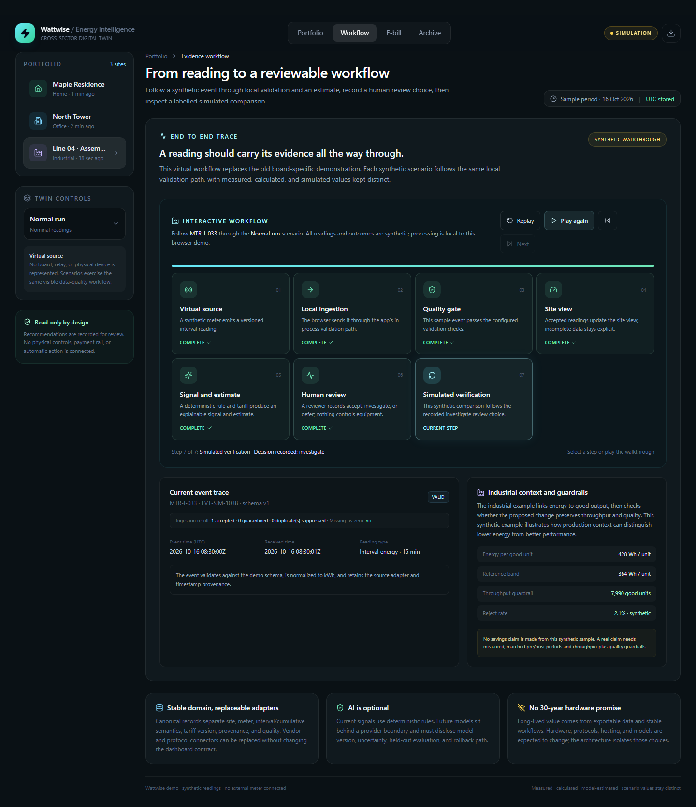

# Interactive workflow walkthrough

The Workflow view is a browser animation for explaining the prototype's synthetic evidence path. It is not a standalone video or a live ingestion pipeline.

## Run the walkthrough

1. Start the app with `npm ci` and `npm run dev`.
2. Open **Workflow** in the top navigation and select a site and scenario in the left panel.
3. Select **Play** to animate through virtual source, local ingestion, the quality gate, site view, and signal/estimate.
4. Playback pauses at **Human review**. Choose **Accept**, **Investigate**, or **Defer**. The selection is in-memory demo state, is included in the synthetic evidence JSON, and does not control equipment or persist between sessions.
5. Select **Next** or **Play** to reach the labelled simulated verification step. The final step is a demonstration outcome; it does not prove real savings or a real intervention.
6. Select any unlocked stage to inspect it directly. The final verification stage stays locked until a review choice is recorded.

When the browser or operating system requests reduced motion, automatic playback is replaced by manual **Advance one step** navigation. The review gate still applies.

## What the stages mean

| Stage | Prototype behavior | Limit |
|---|---|---|
| Virtual source | Creates a versioned synthetic interval reading | No meter or hardware is connected |
| Local ingestion | Sends the sample through in-process validation | No server API, queue, or persistent stream |
| Quality gate | Shows accepted, duplicate, quarantined, or stale outcomes | Faults are deterministic demo scenarios |
| Site view | Presents accepted sample values and freshness context | No live portfolio or alert service |
| Signal and estimate | Shows a rule outcome and deterministic tariff estimate | No AI diagnosis or official charge |
| Human review | Records Accept, Investigate, or Defer in local state | No account, audit database, or operational action |
| Simulated verification | Shows the illustrative after-state | No causal evidence or measured customer savings |

## Browser check and screenshot

The Playwright test `interactive workflow plays through its evidence stages and honors reduced motion` checks the stage progression, decision gate, replay, and manual reduced-motion control. It generates `docs/assets/ebill-walkthrough/05-interactive-workflow.png` from the production build. All five Chromium tests passed locally and in [PR #9 CI run 40652238258](https://github.com/SheeshDarth/smart-electricity-billing-system/actions/runs/40652238258). The [five-image artifact](https://github.com/SheeshDarth/smart-electricity-billing-system/actions/runs/40652238258/artifacts/12800421573) is retained for 30 days.
